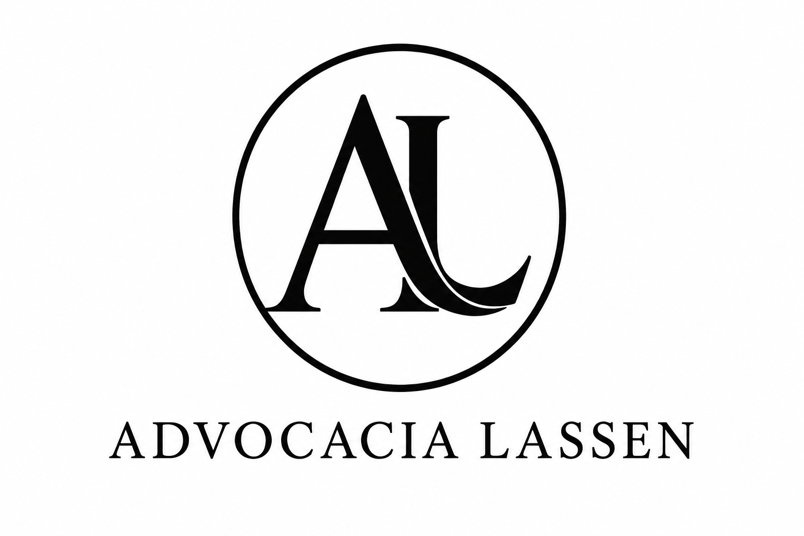

<p align="center"></p>

# Skills da Advocacia Lassen

Acervo privado com 25 skills para trabalho jurídico, pesquisa acadêmica, documentos, gestão e comunicação. Exportação da versão 1.3.0, preparada para Claude Code, com as instruções e os três logotipos existentes.

O pacote orienta o trabalho e não fornece acesso a tribunais, CRM, áudio, Word ou serviços externos. Os recursos efetivos dependem do ambiente. Nenhuma skill assina, protocola, compartilha ou contata terceiros por conta própria.

## Usar localmente sem instalar

Com Claude Code já instalado e autenticado, abra um terminal na raiz deste repositório:

```sh
claude --plugin-dir ./plugins/advocacia-lassen
```

Na sessão, invoque por exemplo:

```text
/advocacia-lassen:sistema-juridico-lassen
/advocacia-lassen:lassen-depoimentos-transcricoes
/advocacia-lassen:lassen-pesquisa-academica
/advocacia-lassen:lassen-redacao-de-pecas
```

O argumento aponta para o diretório do plugin. A raiz deste repositório é o marketplace. A organização e o prefixo dos comandos seguem a [documentação de criação de plugins](https://code.claude.com/docs/en/plugins/create).

## Instalar pelo marketplace privado

A conta GitHub usada pelo Claude Code precisa ter acesso autorizado ao repositório. Não grave tokens neste projeto. A autenticação não é criada nem alterada pelo pacote.

Execute no terminal, se desejar instalar:

```sh
claude plugin marketplace add advlassen/advocacia-lassen-skills
claude plugin install advocacia-lassen@advocacia-lassen-skills
```

Alternativa a partir de uma cópia local:

```sh
claude plugin marketplace add .
claude plugin install advocacia-lassen@advocacia-lassen-skills
```

As etapas de catálogo e instalação são descritas na [documentação oficial de marketplaces](https://code.claude.com/docs/en/plugin-marketplaces). A entrada usa uma origem relativa ao repositório conforme a [referência de marketplaces](https://code.claude.com/docs/en/plugins/marketplace-reference).

## Organização

- `.claude-plugin/marketplace.json`: catálogo com um plugin.
- `plugins/advocacia-lassen/.claude-plugin/plugin.json`: identidade e versão do plugin.
- `plugins/advocacia-lassen/skills/`: 25 diretórios com `SKILL.md` e referências próprias.
- `plugins/advocacia-lassen/references/`: regras comuns, fluxo auditável e guia de modelos locais.
- `plugins/advocacia-lassen/assets/`: três logotipos sem redesenho.

As skills usam nome e descrição no frontmatter e mantêm os arquivos de apoio dentro do plugin. Consulte a [documentação oficial de skills](https://code.claude.com/docs/en/skills).

## Modelos e privacidade

Os sete DOCX privados e os cinco HTML internos não acompanham esta exportação. Os DOCX têm dados profissionais, contatos ou metadados pessoais; o exemplar de petição também contém narrativa demonstrativa. Os HTML incluem scripts, imagens embutidas e fontes externas sem documentação de licença suficiente para redistribuição. Não foram alterados no plugin privado.

Para produzir documentos com fidelidade visual, disponibilize o modelo apropriado separadamente em ambiente autorizado. Leia o [guia de modelos locais](plugins/advocacia-lassen/references/modelos-locais.md). Não adicione documentos preenchidos, autos, dados de clientes, credenciais ou backups a este repositório.

## Conferência e limites

A preparação conferiu JSON, frontmatter, nomes das 25 skills, referências internas, presença dos logotipos e remoção dos identificadores conhecidos. Não equivale a auditoria jurídica de todos os temas nem à execução das skills no Claude Code. Nenhum áudio foi processado e nenhum motor de transcrição foi instalado.

Para conferir o pacote com seu Claude Code, sem instalar o plugin:

```sh
claude plugin validate .
claude plugin validate ./plugins/advocacia-lassen
```

Esses comandos são instruções para o usuário; não foram executados nesta preparação. Versões antigas do Claude Code podem exigir atualização segundo a documentação do fornecedor.

## Direitos e acesso

O repositório é destinado ao uso privado e às pessoas autorizadas pelo proprietário. Não há concessão de licença open-source, autorização geral de redistribuição nem licença de uso da marca. Consulte [direitos e proveniência](NOTICE.md) e [origem da exportação](PROVENANCE.md). Adicionar colaboradores, tornar público ou escolher licença exige decisão específica do responsável.

